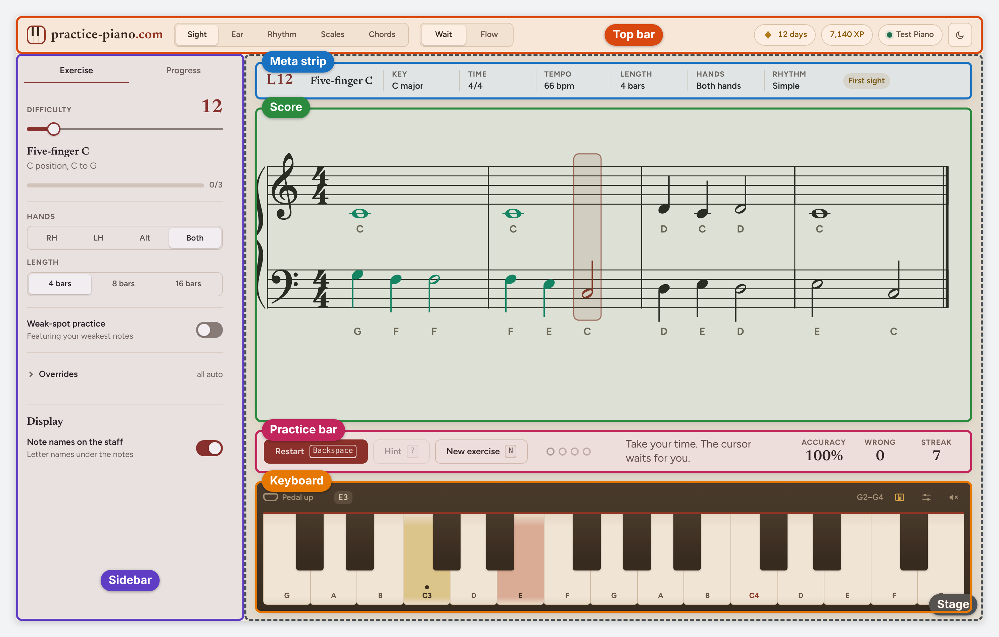

# UI map

Names for the parts of the screen, so issues, pull requests and conversations mean the same thing
by "the meta strip" or "the practice bar". The area names come from the layout guide
([design/system/guides/02-layout.md](../design/system/guides/02-layout.md)), which stays the
source for their sizes and rules. This page adds names for the parts inside them.

The images are taken from the real app (sight reading, Wait mode, a few notes in, 1440 × 900 px)
by `scripts/screenshots/ui-map.spec.ts`. Retake them after a layout change:

```bash
npm run ui-map       # → docs/ui-map/*.png
```

If you add, rename or remove a part, change the list in the script and the tables below together.

## Areas



| Area | What it is | Code |
|---|---|---|
| **Top bar** | The strip across the top, on every screen. | `TopBar.tsx`, `.topbar` |
| **Sidebar** | The panel on the left: settings for the lesson and progress. Below 1080 px wide it becomes the **drawer**, opened from the top bar. | `App.tsx`, `.sidebar` |
| **Stage** | Everything right of the sidebar. It holds four cards, top to bottom. | `App.tsx`, `.stage` |
| **Meta strip** | First card: what this exercise is. | `MetaStrip.tsx`, `.meta-strip` |
| **Score** | Second card, the only one that grows: the music to play. | `ScoreView.tsx`, `.stage > .score` |
| **Practice bar** | Third card: buttons and live feedback for the current run. | `PracticeBar.tsx`, `.practice-bar` |
| **Keyboard** | Fourth card: the on-screen piano and its tools. | `KeyboardDock.tsx`, `.stage > .keyboard` |

## Parts


| # | Part | What it is | Code |
|---|---|---|---|
| | **Top bar** | | |
| 1 | Logo | The wordmark; only the mark stays below 1080 px. | `Logo` in `Icon.tsx` |
| 2 | Lesson switcher | Sight, Ear, Rhythm, Scales, Chords. | `.topbar-lesson` |
| 3 | Mode switch | Wait or Flow, for lessons that have both. | `.topbar-mode` |
| 4 | Streak chip | Days in a row with practice. | `.chip-streak` |
| 5 | XP chip | Experience points. | `.chip-xp` |
| 6 | Piano chip | MIDI status and the piano's name; opens the Piano & audio dialog. | `.chip-midi` |
| 7 | Theme toggle | Light or dark. | `.topbar-right .icon-btn` |
| | **Sidebar** | | |
| 8 | Sidebar tabs | Exercise and Progress. | `Tabs` in `App.tsx` |
| 9 | Exercise panel | The lesson's settings: difficulty, hands, length and so on. One per lesson. | `ExercisePanel.tsx`, `EarPanel.tsx`, `RhythmPanel.tsx`, `ScalesPanel.tsx`, `ChordsPanel.tsx` |
| | **Meta strip** | | |
| 10 | Level and tier | The level number and the tier's name (or the scale or chord title). | `.meta-lead` |
| 11 | Exercise stats | Key, time, tempo, length, hands, rhythm. | `.meta-strip > .stat` |
| 12 | Badges | First sight, weak-spot focus. | `.meta-badges` |
| | **Score** | | |
| 13 | Staff | The engraved exercise, with note names when they are on. | `.score-host` |
| 14 | Cursor | The step to play now, in Wait mode. | `.score-cursor` |
| | **Practice bar** | | |
| 15 | Practice actions | Start or Stop, Hint, Restart, New exercise, Results. | `.practice-actions` |
| 16 | Beat dots | Count-in and the beat in Flow mode. | `.beat-dots` |
| 17 | Practice message | What to do now, and the grade after a run. | `.practice-message` |
| 18 | Practice stats | Live numbers for this run: accuracy, wrong notes, streak. | `.practice-stats` |
| | **Keyboard** | | |
| 19 | Input monitor | Sustain pedal and the notes held right now. | `InputMonitor.tsx` |
| 20 | Keyboard tools | Range, keyboard guide, keyboard display menu, key sound. | `KeyboardControls.tsx` |
| 21 | Keys | The on-screen piano. Guide keys light up the notes to play. | `PianoKeyboard.tsx`, `.keys` |

## Not in the picture

| Name | What it is | Code |
|---|---|---|
| Drawer | The sidebar below 1080 px wide, over the stage with a scrim behind it. | `.sidebar.is-open` |
| Drawer toggle | The menu button at the right end of the top bar below 1080 px. | `.drawer-toggle` |
| Progress panel | The sidebar's Progress tab: XP, mastery, streaks, heatmaps. | `ProgressPanel.tsx` |
| Playhead | The line that moves through the score in Flow mode. | `.score-playhead` |
| Results card | The card over the score after a run: verdict, numbers, piano shortcuts, actions. | `ResultsCard.tsx`, `.results` |
| Keyboard display menu | The popover from the keyboard tools: note names on the keys, computer-key hints, keyboard view. | `.keyboard-popover` |
| Piano & audio dialog | Piano connection, latency, metronome and scoring, opened from the piano chip. | `PianoAudioDialog.tsx` |
| Setup guide | The first-run dialog: connect a piano, calibrate, pick a starting stage. | `GuideDialog.tsx` |
